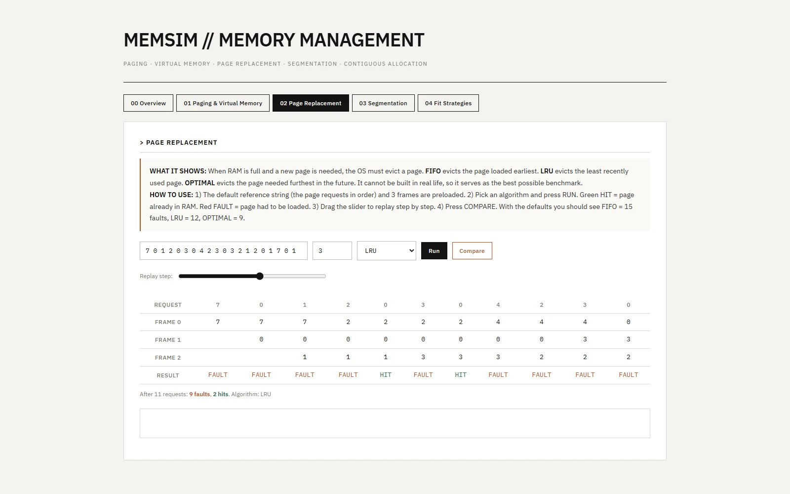
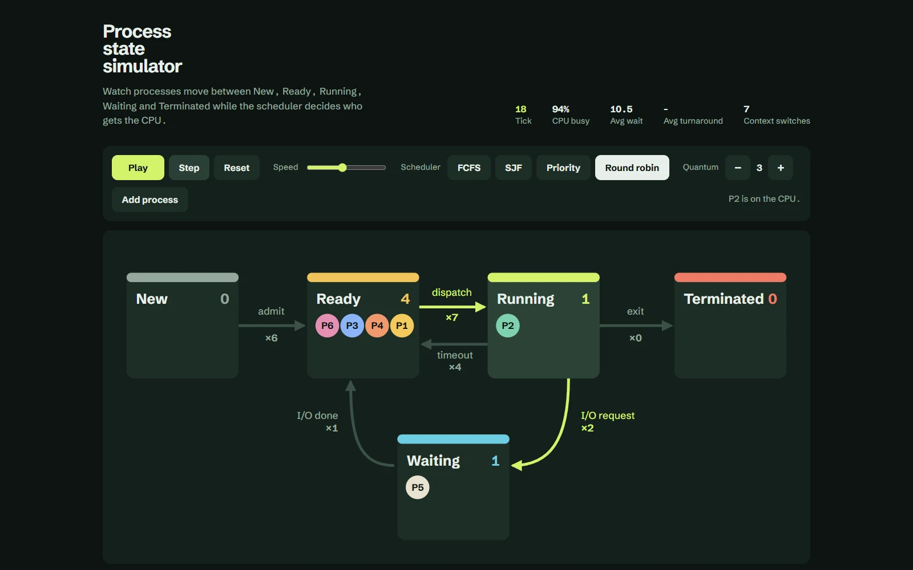

OS Simulators is a set of three interactive tools, one per concept: CPU scheduling, memory management and process states. Each runs in the browser and lets you step through the behaviour instead of reading a static diagram.

## The problem

These operating-systems concepts are usually taught as static diagrams. They are easier to understand when you can step through them.

## The approach

The CPU Scheduler Simulator runs first-come first-served, shortest job first, priority and round robin scheduling. Round robin takes a quantum setting, and results appear as a Gantt chart.

MEMSIM covers paging with page faults, FIFO, LRU and optimal page replacement with a side-by-side compare, segmentation with limit checks that raise a segmentation fault, and first, best and worst fit allocation.

The process state simulator moves processes through New, Ready, Running, Waiting and Terminated. It shows a CPU timeline and live metrics such as average wait, turnaround and context switches.

Each simulator is a single HTML file with no framework or build step.
